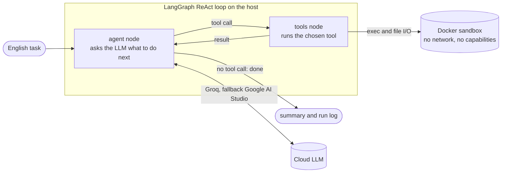

# Autonomous Coding Agent

Give it a task in plain English. It writes code, runs it in a locked-down Docker container, reads the errors, and fixes them until the task works.

Built around a ReAct (Reason, Act, Observe) loop on LangGraph, with free-tier cloud LLMs (Groq, with Google AI Studio as fallback), so it runs on a laptop with no GPU and no paid services.

## How it works



1. The **agent node** sends the conversation to the LLM, which replies with either a tool call or a final answer.
2. The **tools node** runs the call inside a throwaway Docker container and feeds the result back.
3. The loop repeats until the LLM answers without a tool call, or a step limit is reached.

Tools: `run_command`, `read_file`, `write_file`, `edit_file`, `list_dir`, `delete_file`.

## Quick start

Tested on Windows with Docker Desktop. You need Python 3.11+, Docker running, and a free [Groq](https://console.groq.com) API key. A Google AI Studio key is optional and enables the fallback.

```powershell
git clone https://github.com/harshmishra-1702/autonomous-coding-agent.git
cd autonomous-coding-agent
python -m venv venv
venv\Scripts\activate
pip install -r requirements.txt
copy .env.example .env
```

Edit `.env` and fill in your keys and model names, then run a task:

```powershell
python -m agent "Create fizzbuzz.py that prints FizzBuzz for 1 to 15, then run it."
```

Files the agent creates appear in `workspace/`, and every run writes a step-by-step log to `logs/`.

Run the tests (Docker must be running, no API keys needed):

```powershell
pytest -q
```

## Example run

The task was: *"test_calc.py is failing. Run it, find the bugs in calc.py, and fix calc.py. Do not change test_calc.py."* This is the agent's own run log, printed with `python -m evals.report`:

```
  1 run_command(cmd='python test_calc.py', timeout='120') -> exit_code=1 | AssertionError
  2 read_file(line_end='400', line_start='1', path='calc.py') -> exit_code=0 (ignored args)
  3 read_file(line_end='200', line_start='1', path='test_calc.py') -> exit_code=0 (ignored args)
  4 edit_file(new='return a + b', old='return a - b', path='calc.py') -> exit_code=0
  5 edit_file(new='return n % 2 == 0', old='return n % 2 == 1', path='calc.py') -> exit_code=0
  6 run_command(cmd='python test_calc.py', timeout='120') -> exit_code=0 | ok
  7 -- done: Fixed the bugs in `calc.py`:

- Corrected `add` to perform addition instead of s
summary: 6 tool calls (run_command x2, read_file x2, edit_file x2) | ignored args: 2 | done at step 7
```

## Results

A small evaluation suite of 10 tasks (writing programs, fixing bugs, multi-file edits, precise edits to similar-looking lines). Each task runs 3 times and is graded by running the result in the sandbox, not by trusting the agent's own summary.

Score: 30/30

| Task | Passed | Avg time |
|---|---|---|
| fizzbuzz | 3/3 | 8s |
| stdin_sum | 3/3 | 8s |
| fix_bug | 3/3 | 24s |
| small_edit | 3/3 | 17s |
| add_with_test | 3/3 | 19s |
| fix_failing_test | 3/3 | 54s |
| rename_across_files | 3/3 | 50s |
| csv_total | 3/3 | 22s |
| distinct_words | 3/3 | 28s |
| edit_similar_lines | 3/3 | 17s |

Details and history are in [docs/EVALS.md](docs/EVALS.md). The reports helped find real bugs: for example, one slow task turned out to be a misconfigured context budget plus attempts to run a tool the sandbox does not have.

## Design decisions

- **Sandboxing:** all generated code runs in an ephemeral container with no network, all Linux capabilities dropped, memory and process limits, and only the `workspace/` folder mounted. Stale containers from killed runs are removed at startup.
- **Context management:** each tool output is truncated, and when the history grows too large, the oldest tool outputs shrink to one-line stubs while the newest stay intact.
- **Reliability:** retries with backoff, automatic failover from Groq to Google (including the thought-signature handling Gemini requires), loop detection, a warning two steps before the step limit, and tolerant tool calls (invented arguments are ignored and reported).
- **Measured, not guessed:** an eval suite with repeat runs and a trajectory report turned vague failures into specific fixes.

## Limitations

- Tested on Windows with Docker Desktop only.
- Free-tier models vary from run to run, so results are pass rates, not guarantees, and free-tier rate limits apply.
- The sandbox has no network and no pytest or pip installs, so tasks that need extra packages will not work.
- The eval suite is small (10 tasks).
- The sandbox hardening reduces risk but is not a security audit.

## Project map

```
agent/
  __main__.py   CLI entry point: python -m agent "task"
  graph.py      LangGraph loop: agent node, tools node, step and repeat limits
  llm.py        Groq client with retries, Google fallback, signature handling
  tools.py      the tools the LLM can call
  sandbox.py    Docker sandbox
  common.py     system prompt, message helpers, history compaction
evals/          evaluation suite and trajectory report
tests/          unit tests (fake LLM, real Docker for the sandbox)
docs/           SRS, roadmap, progress log, eval results
```

The full requirements are in [docs/SRS.md](docs/SRS.md).